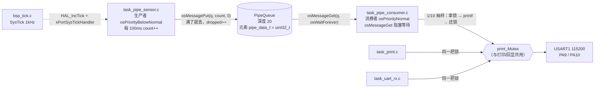

# FreeRTOS 学习工程（STM32F103C8T6 / BluePill）

一个**边学边写**的 FreeRTOS 工程集合：用 STM32F103C8T6 最小系统板（BluePill）+ PlatformIO +
ST 官方 `stm32cube` 框架 + CMSIS-RTOS v1（`osThreadDef` / `osMessageQ` / `osSemaphore` 那一套
API），把"任务、队列、信号量、互斥量"这些概念一个个落到能烧进板子的代码上。

不是产品固件，不追求功能完整；目标是**每一块代码都能讲清楚为什么这么写**。
所以源码注释普遍偏长，尤其是"参数为什么取这个值""这样写会踩什么坑"。

---

## 1. 仓库结构

```
freertos/
├── platformio.ini            # 根工程（FreeRTOS 主工程）配置
├── add_freertos.py           # 【关键】把框架自带的 FreeRTOS 内核注入构建（pre: 脚本）
├── include/
│   └── FreeRTOSConfig.h      # 内核配置：7 个优先级 / 1kHz tick / 15KB heap / 互斥量开关
├── src/
│   ├── main.c                # 板级初始化 → 创建内核对象 → 创建任务 → 启动调度器
│   ├── bsp/                  # 板级支持包（每个外设一个模块，HAL 句柄模块内 static）
│   │   ├── bsp_clock.c/.h    # 72MHz 时钟，HSE 起振失败自动回退 HSI 8MHz
│   │   ├── bsp_gpio.c/.h     # 板载 LED(PC13) / 蜂鸣器(PA0) GPIO
│   │   ├── bsp_tick.c        # SysTick 统一入口：HAL 时基 + FreeRTOS 时基
│   │   ├── bsp_uart.c/.h     # USART1 115200 + 环形缓冲 + printf 重定向(_write)
│   │   ├── my_uart.c         # 手写 UART 练习实现（与 bsp_uart 重叠，_write 为 weak）
│   │   └── bsp_params.h      # 任务间共享参数结构体 task_params_t
│   └── tasks/                # 每个任务一个 .c/.h，对外只暴露 Xxx_Create()
│       ├── task_led.c/.h
│       ├── task_buzzer.c/.h
│       ├── task_print.c/.h
│       ├── task_uart_rx.c/.h
│       ├── task_pipe.h            # 流水线公共定义：元素类型/深度/抽样率/统计结构
│       ├── task_pipe_sensor.c/.h  # 生产者：10Hz 递增计数 → 队列
│       └── task_pipe_consumer.c/.h # 消费者：阻塞取数 → 1/10 抽样打印
└── practice/                 # 独立 PlatformIO 工程：蓝桥杯练习（裸机，无 RTOS）
    ├── platformio.ini
    ├── include/key.h
    └── src/key.c、src/main.c
```

> `practice/` 是**另一个 PlatformIO 工程**（有自己的 `platformio.ini` 和 `.pio/`）。
> 在仓库根目录执行 `pio run` 不会编译它，必须 `cd practice` 再 `pio run`。

---

## 2. 硬件与接线

| 项目 | 说明 |
|------|------|
| MCU | STM32F103C8T6（72MHz，64KB Flash / 20KB RAM） |
| 板卡 | BluePill 最小系统板（8MHz 晶振） |
| 调试器 | ST-Link（SWD：3.3V / SWDIO / SWCLK / GND） |
| 串口 | USART1：PA9(TX) → USB-TTL RX，PA10(RX) → USB-TTL TX，GND 共地，115200-8-N-1 |
| LED | 板载 PC13，**低电平点亮** |
| 蜂鸣器 | 外接有源蜂鸣器 → PA0（低电平响），BluePill 板载没有蜂鸣器 |

---

## 3. 构建 / 烧录 / 监视

```bash
# 根工程（FreeRTOS 主工程）
pio run                 # 只编译
pio run -t upload       # 编译 + ST-Link 烧录
pio run -t clean        # 清理
pio device monitor -b 115200

# practice 工程（蓝桥杯练习，裸机）
cd practice
pio run
pio run -t upload
```

平台/工具链版本（本机验证）：PlatformIO Core 6.1.19、`ststm32` 19.5.0、
`framework-stm32cubef1` 1.8.6、`toolchain-gccarmnoneeabi` 7.2.1。

### 为什么需要 `add_freertos.py`

`framework = stm32cube` 只会编译 HAL/CMSIS 设备层，**不会**编译框架包里的
`Middlewares/Third_Party/FreeRTOS`。所以 `platformio.ini` 里必须有：

```ini
extra_scripts = pre:add_freertos.py
```

脚本做两件事：把 FreeRTOS 的 `include/`、`portable/GCC/ARM_CM3`、`CMSIS_RTOS/`
加进头文件搜索路径；用 `env.BuildSources()` 把内核 `*.c` + `port.c` +
`heap_4.c` + `cmsis_os.c` 纳入编译。**删掉它，`#include "cmsis_os.h"` 立刻找不到，
链接也会缺 `xTaskCreate` 等符号。**

---

## 4. 任务一览

| 任务 | 文件 | 优先级（CMSIS / FreeRTOS 实际值） | 栈 | 周期 | 职责 |
|------|------|-----------------------------------|----|------|------|
| LED 心跳 | `task_led.c` | Normal / 3 | 128 word | 500ms | 翻转 PC13，证明调度器在跑 |
| 蜂鸣器 | `task_buzzer.c` | Normal / 3 | 128 word | 事件驱动 | 等 `'b'` 命令的信号量，响 100ms |
| 打印 | `task_print.c` | Normal / 3 | 128 word | 100ms | 持 `print_Mutex` 逐字符打印一行状态 |
| 串口回显 | `task_uart_rx.c` | Normal / 3 | 128 word | 5ms 轮询 | 解析 `'1'/'0'/'b'`，未知字符回显 |
| 流水线生产 | `task_pipe_sensor.c` | **BelowNormal / 2** | 128 word | 100ms | `count++` → `osMessagePut` 入队，统计丢包 |
| 流水线消费 | `task_pipe_consumer.c` | Normal / 3 | 192 word | 队列驱动 | `osMessageGet` 阻塞取数，1/10 抽样打印 |

优先级换算：本 port 的 `cmsis_os.c` 里 `makeFreeRtosPriority()` 是
`FreeRTOS 优先级 = osPriority + 3`，`osPriorityIdle(-3)` 对应 0。
`configMAX_PRIORITIES = 7`，所以 CMSIS 侧只能用到 `Idle…Realtime`（-3…+3）。

**生产者必须比消费者低一级**：队列满时如果生产者优先级更高（或同级），
消费者抢不到 CPU 去取数据，生产者却一直占着 CPU 重试 → 队列永远不空。

---

## 5. 队列流水线数据流



ASCII 简版：

```
[生产者 10Hz] --osMessagePut(timeout=0)--> [Queue 深度20] --osMessageGet(osWaitForever)--> [消费者]
      |                                          |                                            |
   sent/dropped 统计                       osMessageWaiting() 取实时深度              每 10 条 printf 1 条
      |                                          |                                            |
      +---------------- GetStats() 临界区快照 -----+--------------------------------------------+
                                                                                            |
                                                                        print_Mutex（与打印/回显共用）
                                                                                            |
                                                                                       USART1 115200
```

串口预期输出（约 1 行/秒 + 每 5 秒一行汇总）：

```
[Boot] BluePill UART ready
[Print] FreeRTOS on STM32F103 running
[Pipe] rx=10 seq=10 printed=1 sent=10 drop=0 q=0
[Pipe] rx=20 seq=20 printed=2 sent=20 drop=0 q=0
...
[Pipe] stats rx=50 printed=5 sent=50 drop=0 q=0
```

---

## 6. CMSIS-RTOS v1 API 速查（本工程实际用法 + 坑）

### 6.1 线程：`osThreadDef` / `osThread` / `osThreadCreate`

```c
/* 定义（.c 文件里，文件作用域） */
osThreadDef(PipeSensorTask, PipeSensor_Handler, osPriorityBelowNormal, 1, 128);
/*            ↑线程名标识符   ↑函数指针            ↑优先级        ↑实例数 ↑栈(word) */

/* 创建 */
osThreadCreate(osThread(PipeSensorTask), NULL);   /* 第二个参数 = 传给任务的 void* */
```

- **第一个参数是标识符，不是函数**。宏展开是
  `const osThreadDef_t os_thread_def_##name = { #name, (thread), ... }`，
  它只用来拼变量名和任务名字符串。写成 `osThreadDef(Foo, Foo, ...)` 能编过
  （两个参数在不同命名空间），但调试器里任务名和函数名一样，栈回溯时分不清。
  本工程统一：`osThreadDef(XxxTask, Xxx_Handler, ...)`。
- **栈单位是 word（4 字节）**，128 就是 512 字节。带 `printf` 的任务给 192 以上。
- 任务函数签名固定 `void func(void const *argument)`，不用的参数记得 `(void)argument;`。
- 调度器启动**前**创建的任务在 `osKernelStart()` 后按优先级开跑；
  启动**后**创建的任务立刻进入就绪态，可能马上抢占当前任务。

### 6.2 消息队列：`osMessageQDef` / `osMessageCreate` / `osMessagePut` / `osMessageGet`

```c
/* 定义（编译期常量描述符） */
osMessageQDef(PipeQueue, PIPE_QUEUE_DEPTH, pipe_data_t);

/* 创建（运行期向 FreeRTOS heap 申请内存） */
osMessageQId q = osMessageCreate(osMessageQ(PipeQueue), NULL);

/* 发送：成功 osOK，队列满 osErrorOS */
osStatus st = osMessagePut(q, (uint32_t)count, 0);

/* 接收：队列空则阻塞 */
osEvent ev = osMessageGet(q, osWaitForever);
if (ev.status == osEventMessage) { pipe_data_t v = (pipe_data_t)ev.value.v; }

/* 查询当前积压条数（调试/统计用） */
uint32_t depth = osMessageWaiting(q);
```

坑：

1. **元素宽度必须 ≤ 4 字节**。`osMessagePut` 的形参就是 `uint32_t info`，
   `osMessageGet` 也只往 `osEvent.value.v`（uint32_t）里拷贝。元素小于 4 字节时
   高字节是残留值，读出来是"随机数"；要传结构体请用 `osMailQ` 或传指针。
2. **`osMessagePut(..., 0)` 不等于"完全不等待"**。本 port 的 `cmsis_os.c` 里有
   `ticks = millisec / portTICK_PERIOD_MS; if (ticks == 0) ticks = 1;`，
   传 0 实际是"最多等 1 个 tick（1ms）"。对 100ms 的采样周期可忽略，
   但 1kHz 控制环里必须知道这件事。
3. **队列满时 `osMessagePut` 返回 `osErrorOS`**，不是 `osEventTimeout`；调用方要判返回值。
4. **`osMessagePut` 内部不判空句柄**，`q == NULL` 会一路走到 `xQueueSend(NULL,…)`。
   本工程在 `Task_Pipe_*_Create()` 里先判 `q != NULL` 再创建任务。
5. `osMessageGet` 队列空且超时返回 `osEventTimeout`；`osWaitForever` 才不会返回。

### 6.3 信号量：`osSemaphoreDef` / `osSemaphoreCreate` / `osSemaphoreWait` / `osSemaphoreRelease`

```c
osSemaphoreDef(semaphore);
osSemaphoreId sem = osSemaphoreCreate(osSemaphore(semaphore), 1);
(void)osSemaphoreWait(sem, 0);          /* 取走初始令牌 → 开机"无令牌" */

osSemaphoreWait(sem, osWaitForever);    /* 任务里等 */
osSemaphoreRelease(sem);                /* 任务或中断里给（内部会判 inHandlerMode） */
```

**这是本仓库最容易踩的一个坑**（原 `main.c` 就写错了）：

- `count == 1` → `vSemaphoreCreateBinary()`，而且这个宏**创建后立刻 give 一次**，
  所以信号量是"有令牌"状态；
- `count != 1` → `xQueueCreateCountingSemaphore(count, count)`，
  而 `queue.c` 第一行是 `configASSERT(uxMaxCount != 0)`；
- 于是 `count = 0` **不是"初值 0"**，而是"最大计数为 0 的计数信号量"，
  直接触发 `configASSERT` 里的 `for(;;)`，板子卡死在 `osKernelStart()` 之前。

正确姿势（本工程采用）：`count = 1` 创建二进制信号量，然后立刻
`osSemaphoreWait(sem, 0)` 把初始令牌吃掉。

### 6.4 互斥量：`osMutexDef` / `osMutexCreate` / `osMutexWait` / `osMutexRelease`

```c
osMutexDef(printmutex);
osMutexId m = osMutexCreate(osMutex(printmutex));

osMutexWait(m, osWaitForever);   /* 拿钥匙 */
printf("...");                   /* 独占串口 */
osMutexRelease(m);               /* 还钥匙：谁借谁还 */
```

- 本 port 的 `osMutexCreate()` 走 `xSemaphoreCreateMutex()`，**不可重入**：
  同一个任务对同一把锁连续 `osMutexWait` 两次会自己锁死自己。
  拿锁期间不要调用"也会拿这把锁"的函数。
- 互斥量有优先级继承（`configUSE_MUTEXES = 1`），能缓解优先级翻转，
  但不能解决"持锁做长时间阻塞操作"的问题——所以 `printf` 之后立刻还锁。
- `print_Mutex` 被 `task_print`、`task_uart_rx`、`task_pipe_consumer` 三方共用，
  目的就是让串口任何时刻只有一个人在"整行说话"。

### 6.5 本工程的内核配置要点（`include/FreeRTOSConfig.h`）

| 配置 | 值 | 影响 |
|------|----|------|
| `configMAX_PRIORITIES` | 7 | CMSIS 侧可用 -3…+3 共 7 级 |
| `configTICK_RATE_HZ` | 1000 | 1 tick = 1ms，`osDelay(100)` = 100ms |
| `configTOTAL_HEAP_SIZE` | 15KB | `osThreadCreate`/`osMessageCreate` 都从这里分配 |
| `configUSE_MUTEXES` | 1 | 互斥量可用 |
| `configUSE_COUNTING_SEMAPHORES` | 1 | `osSemaphoreCreate(count>1)` 可用 |
| `configCHECK_FOR_STACK_OVERFLOW` | 0 | 栈溢出不会报错（见"已知限制"） |
| `configGENERATE_RUN_TIME_STATS` | 0 | 没有 CPU 占用率统计 |

`SysTick_Handler` 由 `bsp_tick.c` 自己实现：先 `HAL_IncTick()` 喂 HAL 时基，
调度器启动后再调 `xPortSysTickHandler()`。**不要把 FreeRTOS 的
`xPortSysTickHandler` 宏改名成 `SysTick_Handler`**，否则 `HAL_Delay()` 永远不返回。

---

## 7. 串口命令

| 输入 | 效果 |
|------|------|
| `1` | PC13 强制点亮（会被 LED 心跳任务 500ms 后覆盖） |
| `0` | PC13 强制熄灭（同上） |
| `b` | 释放信号量 → 蜂鸣器响 100ms |
| 其它 | 回显 `Unknown command: 'x'`（持 `print_Mutex`） |

---

## 8. `practice/` —— 蓝桥杯练习工程（独立、裸机）

**状态：可编译、可烧录；功能扩展暂停（不再往里加新模块）。**

- 与主工程定位不同：主工程练 FreeRTOS，`practice/` 练蓝桥杯嵌入式赛题的裸机套路
  （20ms 节拍 + 非阻塞状态机）。真实赛板是 CT117E-M4（STM32G431RBT6），
  这里用同一块 F103 练 GPIO/HAL 写法，迁移时主要改时钟树和引脚映射。
- 已实现：
  - `include/key.h` + `src/key.c`：按键驱动（PA1 内部上拉、20ms 周期扫描、
    60ms 计数式消抖、短按/长按事件回调、按住时长查询）；
  - `src/main.c`：`HAL_Init` + 时钟（HSE 72MHz，失败回退 HSI 64MHz）+
    `SysTick_Handler` + 20ms 扫描节拍 + LED 指示（短按翻转、长按 250ms 快闪）。
- 该工程**不使用 FreeRTOS**，也不依赖 `add_freertos.py`。

---

## 9. 已知限制

1. **PC13 被三处代码抢**：`LED_Beacon()`（启动自检）、LED 心跳任务（500ms 翻转）、
   串口 `'1'/'0'` 命令。三者会互相覆盖，属于教学演示的取舍，不是 bug 但别指望
   `'1'` 能让灯一直亮着。
2. **队列满时丢数据**（生产端 `timeout = 0`）。这是刻意选择：保采样节拍、
   把"下游跟不上"暴露成 `drop` 计数。需要零丢失就改 `osWaitForever`，
   代价是消费者卡住时生产者一起停摆。
3. **`configCHECK_FOR_STACK_OVERFLOW = 0`**：栈溢出不会报错，只会莫名其妙 HardFault。
   要排查就把 `FreeRTOSConfig.h` 里改成 2 并提供 `vApplicationStackOverflowHook`。
4. **RAM 余量不多**：静态占用约 79%（16172/20480 字节），其中 15KB 是 FreeRTOS heap。
   再加任务/队列要同时盯 `.bss` 和 heap 余量（`xPortGetFreeHeapSize()`）。
5. **没有运行统计**：`configGENERATE_RUN_TIME_STATS = 0`、`configUSE_TRACE_FACILITY = 1`
   但没接 `vTaskList` 输出，CPU 占用率/各任务栈水位都看不到。
6. **`my_uart.c` 与 `bsp_uart.c` 功能重叠**：两者都实现 `_write`，
   `my_uart.c` 里的那份用 `__attribute__((weak))` 让位给 `bsp_uart.c` 的强符号。
   它只是"手写 UART"的练习留档，不参与实际输出路径。
7. **`practice/` 与根工程共用同一块板子**：烧录 practice 会覆盖 FreeRTOS 固件，
   两者不能同时存在，切换要重新 `pio run -t upload`。
8. 仓库里历史遗留的 `compile_commands.json` 是 IDE 生成的编译数据库（绝对路径），
   换机器后内容会失效，仅作参考。
9. **未上板验证**：本仓库的所有构建结论来自 `pio run`（编译/链接），
   串口输出时序、按键手感、长时间运行稳定性都需要实际烧录确认。

---

## 10. 整理记录

- `build_log.txt`：早期手工粘贴的一次构建输出（无持续价值），已删除并加入 `.gitignore`。
- `add_freertos.py`：机制未改动（仍是 `pre:` 注入 + `env.BuildSources`）。
